  

### Projetos que construí

  
  
  
  
  
  

<a href="https://leonardoanthony.dev/projetos"><b>Ver todos os projetos →</b></a>

### Stack

  

  
  
  
  
  
  

### Onde já trabalhei

  
<b>Ritmo no GitHub</b>

   
  

  
  
  
  

